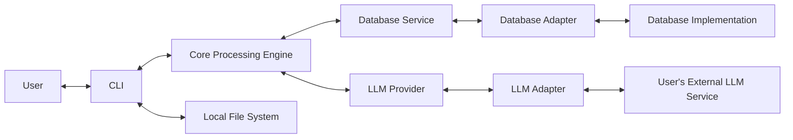

# System Architecture

## 1. System Architecture

CVBrewer is composed of several components that work together to provide resume processing and generation functionality. These components have distinct responsibilities and communicate with one another to complete application workflows.

The main application components are:

- Command-Line Interface (CLI)

- Core Processing Engine

- Database Service

- Database Adapter

- LLM Provider

- LLM Adapter

The application also uses external resources:

- Local File System

- User-provided Large Language Model (LLM) service

The LLM is an **external service** that the user must install and configure themselves. It is not bundled with the application. The application includes the components needed to communicate with supported LLM services.

The CLI and Core are logically separate components with distinct responsibilities, but they are **not independently deployed**. They are bundled together as a single executable. Their separation exists to keep user interaction and local file management distinct from the application's primary processing logic.

The Database Service and its selected Database Adapter are application components. They are included with the application and work together to access the selected database implementation. The database itself may be embedded in the application environment or provided by an independently running database service.

The LLM Provider and selected LLM Adapter are also application components. They communicate with the user's separately installed or hosted LLM service.

### System Overview

The arrows represent communication between components. A request may receive a response, result, or status from the component it communicates with.

## 2. Components and Responsibilities

### 2.1. CLI

The CLI is the user-facing component responsible for interacting with the user and managing local application resources.

**Responsibilities:**

- Handle user interaction and input.

- Discover and check the designated input and output folders.

- Create and manage input and output folders.

- Discover files in the input folder.

- Coordinate resume upload and generation workflows with the Core.

- Provide the Core with access to the files required for processing.

- Coordinate saving generated resume Markdown files in the output folder.

- Leave the acquisition and removal of uploaded files in the input folder to the user.

**Local File Management:**

- The CLI owns the management of the application's input and output folders.

- The CLI manages access to files in those folders.

- The CLI does not modify or delete uploaded files in the input folder as part of the upload workflow.

- The CLI saves generated Markdown files in the designated output folder.

**Deployment Note:** The CLI is not independently deployable. It exists as part of the combined CLI/Core executable.

### 2.2. Core Processing Engine

The Core is responsible for the application's primary processing logic and resume-related workflows. It coordinates processing tasks and uses the Database Service and LLM Provider when their capabilities are required.

**Responsibilities:**

- Validate PDF structure, accessibility, and extractability.

- Extract text from uploaded resume PDFs.

- Extract deterministic resume data.

- Coordinate LLM-based extraction and parsing when required.

- Validate parsed resume data against the resume JSON schema.

- Validate job descriptions and their parsed data against the job description JSON schema.

- Generate resume data using stored resume data and a job description.

- Validate generated resume data against the generated resume JSON schema.

- Manage resume templating and map generated resume data to the selected template.

- Render the generated resume template as Markdown.

- Request data storage and retrieval through the Database Service.

- Communicate with the LLM through the LLM Provider.

**Responsibility Boundaries:**

- The Core handles file-type checks, PDF validation, and content processing. The CLI performs file discovery and coordinates processing with the Core.

- The Core does not directly depend on a specific database implementation.

- The Core does not directly communicate with a specific LLM implementation.

- The Core uses the Database Service for structured application data and the LLM Provider for language-processing tasks.

**Deployment Note:** The Core is not independently deployable. It exists as part of the combined CLI/Core executable.

### 2.3. Database Service

The Database Service manages application-level data operations and persistence logic. It provides a consistent way for the application to create, retrieve, update, and delete structured data without depending on a specific database technology.

**Responsibilities:**

- Provide universal data operations for creating, retrieving, updating, and deleting records.

- Apply application-level rules related to data management.

- Enforce retention policies on stored parsed resume data.

- Provide data retrieval and query capabilities required by the application.

- Coordinate data operations through the selected Database Adapter.

- Return results to the requesting application component.

- Keep database-specific implementation details separate from the rest of the application.

**Responsibility Boundaries:**

- The Database Service defines and manages application-level data operations.

- The Database Service does not implement database-specific queries, connection handling, or ORM behavior.

- All database operations are carried out through the selected Database Adapter.

- The Database Service should not need to change when the underlying database implementation is replaced, provided the replacement adapter supports the required operations.

**Data Ownership:**

- The Database Service is responsible for managing structured application data stored in the database.

- The database is the source of truth for persisted structured application data.

- Original uploaded PDFs and generated Markdown files are managed by the CLI through the local file system, not by the Database Service.

### 2.4. Database Adapter

The Database Adapter connects the Database Service to the selected database implementation. It handles the database-specific work required to execute the operations requested by the Database Service.

**Responsibilities:**

- Implement the database operations required by the Database Service.

- Manage database connections and connection lifecycle.

- Configure and use the ORM, if one is selected.

- Translate data operations from the Database Service into database-specific queries or ORM operations.

- Execute database queries and transactions.

- Map database results into the data structures expected by the Database Service.

- Handle database-specific error translation and reporting.

- Manage database-specific migrations, indexes, constraints, and other database features.

- Support different database implementations through compatible adapter implementations and application configuration.

**Responsibility Boundaries:**

- The Database Adapter handles database-specific implementation details.

- The Database Adapter does not decide application-level data management rules.

- The Database Adapter implements the operations required by the Database Service.

- A different database implementation can be supported by providing another compatible adapter, without requiring changes to the Database Service's application-level logic.

### 2.5. LLM Provider

The LLM Provider provides a consistent application-facing interface for language-processing tasks. It manages requests from the Core and communicates with the selected LLM Adapter.

It does not include an LLM implementation. The actual language model runs in a separate service chosen and configured by the user.

**Responsibilities:**

- Provide a consistent interface for the Core to request language-processing tasks.

- Manage the selected LLM configuration.

- Coordinate requests and responses between the Core and the LLM Adapter.

- Keep LLM-specific communication details separate from the Core.

- Handle general request coordination and error reporting.

- Manage prompt construction and context preparation required by application workflows.

- Manage context-window considerations when preparing requests.

**Responsibility Boundaries:**

- The LLM Provider manages application-facing LLM requests.

- The LLM Provider does not perform model inference itself.

- Communication with a specific LLM service is handled by the selected LLM Adapter.

- The LLM Provider should not need to change when another compatible LLM adapter is selected.

**Deployment Note:** The LLM Provider is application code bundled with the CLI/Core executable. It does not bundle an LLM.

### 2.6. LLM Adapter

The LLM Adapter connects the LLM Provider to the user's selected external LLM service. It handles the communication requirements of the specific LLM service.

**Responsibilities:**

- Implement the communication protocol required by the selected LLM service.

- Manage connections and communication with the external LLM service.

- Translate generic requests from the LLM Provider into service-specific API calls or inference requests.

- Convert service responses into the format expected by the LLM Provider.

- Handle service-specific error translation and reporting.

- Support service-specific configuration and model parameters, such as temperature and maximum token settings.

- Support different LLM services through compatible adapter implementations and application configuration.

**Responsibility Boundaries:**

- The LLM Adapter handles communication with a specific external LLM service.

- The LLM Adapter does not perform the application's resume-processing or generation workflow.

- The LLM Adapter does not contain or bundle the LLM itself.

- A different supported LLM service can be used by selecting a compatible adapter and configuring the application.

**Deployment Note:** The LLM Adapter is application code bundled with the CLI/Core executable. The external LLM service is installed, hosted, and configured separately by the user.

### 2.7. Large Language Model (LLM)

The LLM is an **external service** that the user must install, host, or access through a provider and configure themselves. It performs language-processing tasks that require natural language understanding, interpretation, or generation.

**Responsibilities:**

- Extract and parse resume information that cannot be reliably determined through deterministic processing.

- Extract and parse information from job descriptions.

- Generate resume data using the user's stored parsed resume data and the provided job description.

- Perform natural language understanding and generation tasks.

- Process prompts and return generated responses.

**Deployment Note:** The LLM is not bundled with the application. Users must:

- Install and configure a supported local LLM service, or select an external hosted LLM service.

- Provide the required model and service configuration.

- Provide API credentials or other access details when required by the selected service.

- Ensure the required network or local service connectivity is available.

The application supports a locally served LLM and may also support external hosted LLM services. Using a hosted LLM is optional and depends on the user's configuration.

### 2.8. Local File System

The Local File System stores files required by the application. It is accessed and managed by the CLI.

**Responsibilities:**

- Hold uploaded resume PDFs in the user-managed input folder.

- Hold generated resume Markdown files in the output folder.

- Provide file access required by the application during resume processing and generation.

**Responsibility Boundaries:**

- The CLI manages the input and output folders and coordinates file access.

- The Core processes file content provided through the CLI's workflow.

- The Database Service manages structured application data; it does not own the original PDF files or generated Markdown files.

## 3. Deployment and Version Control

### 3.1. Deployment

- The CLI and Core shall be bundled and deployed as a single executable.

- They are logically separate components but are not independently deployable.

- They operate together as one application.

- The Database Service and Database Adapter shall be included as application components.

- The Database Service manages application-level data operations.

- The selected Database Adapter implements database-specific operations.

- An embedded database, such as SQLite, may be used with the application.

- An external database server may be used if a compatible adapter is implemented and configured.

- When an external database is used, the database server is deployed and operated separately from the application executable.

- The LLM Provider and LLM Adapter shall be included as application components.

- The LLM Provider manages application-facing language-processing requests.

- The selected LLM Adapter communicates with the user's chosen LLM service.

- The LLM itself is not included in the application executable.

- Users configure and operate their selected local or hosted LLM service separately.

- Normal application operation shall support a locally served LLM. Users may choose a hosted LLM service if they configure one.

- Changes to a database implementation should not require changes to the Database Service's application-level data operations, provided the replacement adapter supports the required operations.

- Changes to an LLM service should not require changes to the Core's application workflows, provided the replacement adapter supports the required LLM operations.

### 3.2. Version Control

- The project shall follow a monorepo structure.

- The CLI and Core shall be maintained within the same repository.

- The Database Service and Database Adapter implementations shall be maintained within the monorepo.

- The LLM Provider and LLM Adapter implementations shall be maintained within the monorepo.

- Architecture and project documentation shall be maintained alongside the source code.

## 4. Documentation Approach

The project follows a **doc-as-code** approach, where documentation is maintained alongside the source code in the monorepo and managed through version control.

**Principles:**

- Documentation is written in Markdown.

- Architecture, requirements, system rules, data models, and process workflows are documented in version-controlled files.

- Documentation is updated alongside relevant implementation or design changes.

- Documentation is organized to reflect the system's components, responsibilities, and workflows.

---

## 5. Architecture Design Notes

This document describes the components, responsibilities, interactions, and deployment decisions made for CVBrewer.

The architecture reflects the project's current requirements and design decisions. It does not claim to introduce a new or original architectural pattern. Its purpose is to provide a clear guide for developing and maintaining the system.

The separation of components is intended to keep responsibilities clear while allowing the application to remain a single executable. Components do not need to be separate applications or independently deployed services to have distinct responsibilities.
