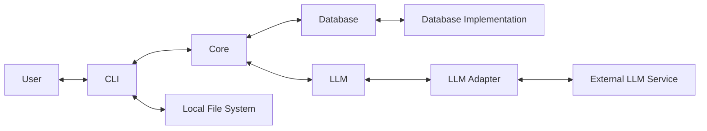

# Architecture

## 1. Architecture Organization

CV Brewer follows a four-level architecture organization model:

| Level     | Description                                                                                     |
| --------- | ----------------------------------------------------------------------------------------------- |
| Component | Groups related Systems and Processes that share a common responsibility within the application. |
| Feature   | Defines what the application should accomplish.                                                 |
| System    | Defines the technical responsibilities supporting features.                                     |
| Process   | Defines workflows that accomplish tasks within systems or components.                           |
| Module    | Defines encapsulated implementation units.                                                      |

### Organization Rules

- Follow the Feature → System → Process → Module hierarchy.
- A system may support multiple features.
- Modules may be shared across systems and processes.
- Avoid unnecessary architecture levels or components.
- These levels do not have to correspond directly to code packages or directories.
- Obtain approval before changing established architectural responsibilities.
- Application-Level Process: A workflow that supports the overall application and is not owned by a specific System.
- System-Level Process: A workflow that performs a specific task within the responsibility of a System.

## 2. System Architecture

CV Brewer is a CLI-based application for processing resumes and generating tailored resumes.

### 2.1. Main Components

| Component   | Responsibility                                                                                 |
| ----------- | ---------------------------------------------------------------------------------------------- |
| CLI         | Handles user interaction and local file management.                                             |
| Core        | Handles resume processing, job description processing, resume generation, and application-level resume data operations. |
| Database    | Implements database-specific operations and adapters for Core-owned data contracts.              |
| LLM         | Provides application-level language-model operations through pluggable LLM adapters.            |

External resources:

- Local File System
- Database Implementation
- User-provided LLM Service

### 2.2. Architecture Overview

### 2.3. Component Boundaries

**CLI**

- Owns input and output folder management.
- Discovers files and performs file-type checks.
- Coordinates application workflows with the Core.
- Must not modify or delete uploaded files during the upload workflow.

**Core**

- Owns PDF validation and content extraction.
- Handles resume and job description processing.
- Handles resume generation and template rendering.
- Constructs prompts and JSON Schemas for language-processing requests.
- Owns the Database Service and application-level resume data operations.
- Uses the Database component through Core-owned repository contracts.
- Uses the LLM Service for language-processing tasks.
- Does not own local file-system management or depend on a specific database or LLM implementation.

**Database**

- Implements Core-owned repository contracts.
- Implements database-specific operations, including connections, queries, transactions, and migrations.
- Keeps database implementation details separate from application logic.
- Does not define application-level operations or record structures.

**LLM**

- Defines the application-level language-model operations used by the Core.
- Defines the plug-in boundary that LLM adapters implement.
- Verifies LLM service availability and lists available models.
- Generates structured responses for language-processing tasks.
- Implements service-specific communication through pluggable LLM adapters.
- Does not contain or bundle the LLM.

**External LLM Service**

- Performs language-processing and generation tasks.
- May be locally hosted or externally provided.
- Must be configured and operated separately from CV Brewer.

**Local File System**

- Stores uploaded resume PDFs and generated Markdown files.
- Is accessed and managed by the CLI.

## 3. Deployment Architecture

- CLI and Core are bundled into one executable.
- Database and LLM components are included in the application.
- The database may be embedded (such as SQLite) or externally hosted.
- External database servers operate separately from the application.
- The LLM is never bundled with the application.
- CV Brewer supports locally hosted LLM services and may support external hosted providers through compatible adapters.

## 4. Repository Architecture

CV Brewer follows a monorepo structure.

- Application components are located under `app/`: `app/cli`, `app/core`, `app/database`, and `app/llm`.
- The Core application layer contains the Database Service under `app/core/services/resume/`.
- Database adapters remain under `app/database/adapters/`.
- The components are packaged as modules of the single `app/` Python project.
- CLI and Core share the same repository.
- Database is maintained in the monorepo.
- LLM Service and LLM adapter implementations are maintained in the monorepo.
- Documentation is maintained alongside source code.
- Logical architecture boundaries do not require separate repositories.
- The component summary and repository structure are documented in `app/README.md`.

## 5. Documentation Approach

The project follows a **doc-as-code** approach.

- Documentation is written in Markdown.
- Documentation is maintained alongside source code.
- Architecture documentation follows the Feature → System → Process organization model.
- Each document describes responsibilities appropriate to its level.
- Documentation is updated alongside relevant architecture and implementation changes.

## 6. Architecture Notes

This document defines CV Brewer's architecture organization, component responsibilities, deployment, and repository structure.

The architecture separates application capabilities, technical responsibilities, workflows, and implementation units without requiring each to become an independent application or deployment unit.
