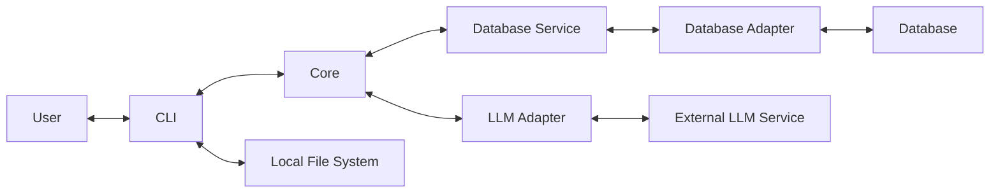

# Architecture

## 1. Architecture Organization

CV Brewer follows a four-level architecture organization model:

| Level   | Description                                                 |
| ------- | ----------------------------------------------------------- |
| Feature | Defines what the application should accomplish.             |
| System  | Defines the technical responsibilities supporting features. |
| Process | Defines workflows that accomplish tasks within systems.     |
| Module  | Defines encapsulated implementation units.                  |

### Organization Rules

- Follow the Feature → System → Process → Module hierarchy.
- A system may support multiple features.
- Modules may be shared across systems and processes.
- Avoid unnecessary architecture levels or components.
- These levels do not have to correspond directly to code packages or directories.
- Obtain approval before changing established architectural responsibilities.

## 2. System Architecture

CV Brewer is a CLI-based application for processing resumes and generating tailored resumes.

### 2.1. Main Components

| Component        | Responsibility                                                                |
| ---------------- | ----------------------------------------------------------------------------- |
| CLI              | Handles user interaction and local file management.                           |
| Core             | Handles resume processing, job description processing, and resume generation. |
| Database Service | Manages structured application data.                                          |
| Database Adapter | Handles database-specific operations.                                         |
| LLM Adapter      | Communicates with external LLM services.                                      |

External resources:

- Local File System
- Database Implementation
- User-provided LLM Service

### 2.2. Architecture Overview

### 2.3. Component Boundaries

**CLI**

- Owns input and output folder management.
- Discovers files and performs file-type checks.
- Coordinates application workflows with the Core.
- Must not modify or delete uploaded files during the upload workflow.

**Core**

- Handles PDF validation and content extraction.
- Handles resume and job description processing.
- Handles resume generation and template rendering.
- Uses the Database Service for structured data.
- Uses the LLM Adapter for language-processing tasks.
- Does not own local file-system management or depend on a specific database or LLM implementation.

**Database Service**

- Defines application-level data operations.
- Manages structured application data.
- Uses the Database Adapter for database access.

**Database Adapter**

- Implements database-specific operations.
- Manages connections, queries, transactions, and migrations.
- Keeps database implementation details separate from application logic.

**LLM Adapter**

- Handles communication with the selected LLM service.
- Translates requests and responses between the Core and external service.
- Does not contain or bundle the LLM.

**External LLM Service**

- Performs language-processing and generation tasks.
- May be locally hosted or externally provided.
- Must be configured and operated separately from CV Brewer.

**Local File System**

- Stores uploaded resume PDFs and generated Markdown files.
- Is accessed and managed by the CLI.

## 3. Deployment Architecture

- CLI and Core are bundled into one executable.
- Database Service, Database Adapter, and LLM Adapter are included in the application.
- The database may be embedded (such as SQLite) or externally hosted.
- External database servers operate separately from the application.
- The LLM is never bundled with the application.
- CV Brewer supports locally hosted LLM services and may support external hosted providers through compatible adapters.

## 4. Repository Architecture

CV Brewer follows a monorepo structure.

- CLI and Core share the same repository.
- Database Service and Database Adapter are maintained in the monorepo.
- LLM Adapter implementations are maintained in the monorepo.
- Documentation is maintained alongside source code.
- Logical architecture boundaries do not require separate repositories.

## 5. Documentation Approach

The project follows a **doc-as-code** approach.

- Documentation is written in Markdown.
- Documentation is maintained alongside source code.
- Architecture documentation follows the Feature → System → Process → Module organization model.
- Each document describes responsibilities appropriate to its level.
- Documentation is updated alongside relevant architecture and implementation changes.

## 6. Architecture Notes

This document defines CV Brewer's architecture organization, component responsibilities, deployment, and repository structure.

The architecture separates application capabilities, technical responsibilities, workflows, and implementation units without requiring each to become an independent application or deployment unit.
