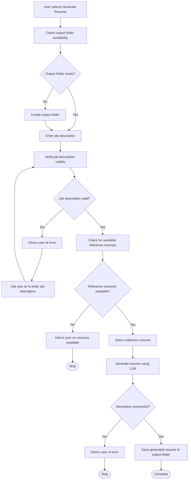

# Resume Generation Feature Overview

## 1. Purpose / Summary

The resume generation feature creates tailored resume documents by combining a user's stored parsed resume data with a provided job description, using an external LLM to generate relevant content that matches the target role. This feature enables users to quickly produce customized resumes for specific job applications without manually rewriting their entire resume history.

## 2. Objective

- Generate a tailored resume document based on stored user resume data and a valid job description
- Use the configured LLM to perform intelligent resume customization and content generation
- Validate generated resume data against the Generated Resume JSON schema before output
- Render the final resume as a Markdown document in the configured output folder
- Ensure generated content respects user's original resume information without fabrication

## 3. User Journey

## 4. Systems

|System|Description|
|---|---|
|[Resume Generation System](../system/resume-generation/overview.md)|Handles the complete resume generation workflow including input validation, LLM integration, and output rendering|

## 5. References

- [System Architecture](../../../architecture.md)
- [Functional Requirements](../../../requirements.md)
- [General System Rules](docs/system-rules.md)
- [Feature Overview Format Rules](docs/rules/format/feature-rules.md)
- [Resume Generation Process](processes/resume-generation-process.md)
- [Job Description Schema](../schema/job-description-schema.md)
- [Generated Resume Schema](../schema/generated-resume-schema.md)
- [Resume Data Model](user-resume.md)
