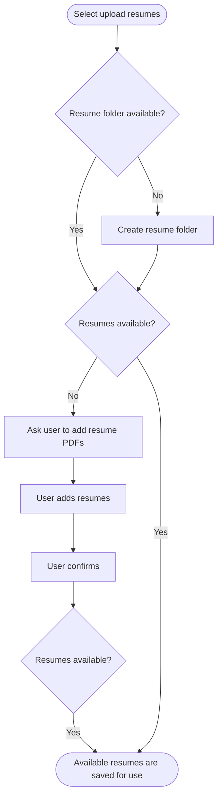

# Resume Upload Feature Overview

## 1. Purpose / Summary

The Resume Upload feature manages the discovery and initial handling of resume files in CVBrewery's designated input folder. It checks folder accessibility, discovers files, and coordinates with the Core Processing Engine to process discovered files and stores successfully parsed resume data when the required storage conditions are satisfied.

This feature handles file discovery, folder management, and processing coordination without performing validation, parsing, or storage operations directly.

## 2. Objective

- Check whether the input folder exists and is accessible.
- Create the input folder if it does not exist according to application rules.
- Determine whether the input folder contains files to process.
- Discover files in the input folder.
- Coordinate eligible files with the Core Processing Engine for resume extraction and parsing.
- Receive processing confirmation and outcomes from the Core Processing Engine.
- Handle individual file processing failures without interrupting other files.
- Complete the upload operation after all discovered files have reached a final outcome.

## 3. User Journey

## 4. Systems

| System | Description |
|--------|-------------|
| [Resume Upload](docs/system/resume-upload/overview.md) | Manages input folder discovery, file coordination with Core Processing Engine, and handles individual file processing outcomes. |
| [Core Processing Engine](docs/system/resume-processing/overview.md) | Handles PDF validation, text extraction, resume parsing, schema validation, and data storage through the Database Service. |

## 5. References

- [Feature Overview Format Rules](docs/rules/format/feature-rules.md)
- [Resume Upload System Overview](docs/system/resume-upload/overview.md)
- [Resume Processing System Overview](docs/system/resume-processing/overview.md)
- [File Type Validation Rules](docs/validation/file-type-validation.md)
- [PDF Validation Rules](docs/validation/pdf-validation.md)
- [Content Extraction Rules](docs/validation/content-extraction-rules.md)
