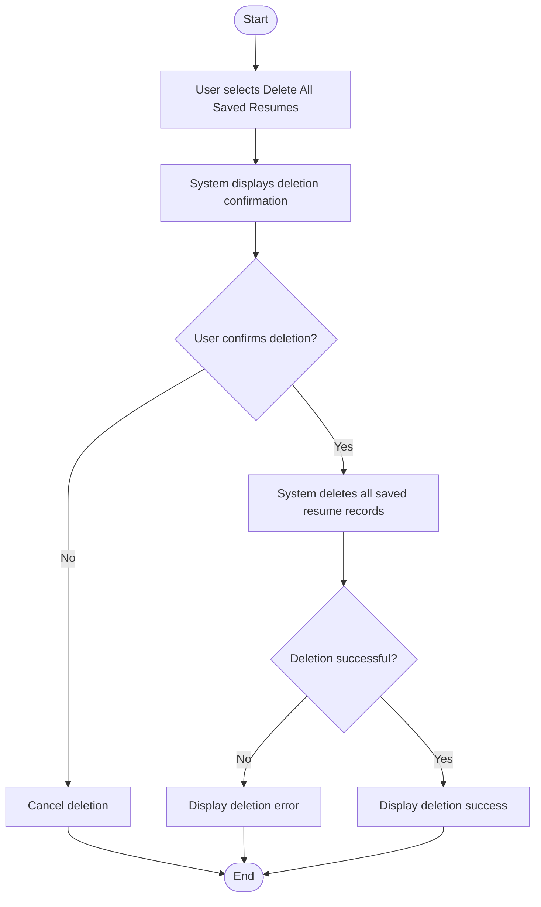

# Uploaded Resume Management Feature Overview

## 1. Purpose / Summary

This feature provides users with the ability to manage their uploaded resumes, specifically allowing them to delete all saved resume records from the system's storage. It enables users to clean up their stored resume data when no longer needed while maintaining security boundaries that prevent access to the input folder and file system beyond parsed resume data deletion. This operation deletes ALL resumes - selective or partial deletion is not supported.

## 2. Objective

- Delete all parsed resume records from the database/storage
- Display a confirmation prompt before deletion occurs
- Provide clear feedback on deletion success or failure
- Prevent accidental deletion of original PDF files in the input folder
- Ensure no write/edit/delete access is granted to the file system beyond stored resume data
- Enforce all-or-nothing deletion (no selective or partial deletion allowed)

## 3. User Journey

## 4. Systems

| System | Description |
|---|---|
| [Delete Resumes System](../system/delete-resumes/overview.md) | Handles the deletion of parsed resume data from storage with security constraints |

## 5. References

- [Requirements Document](../requirements.md) - Section 4.1 Data Categories
- [User Journey Diagram](./uploaded-resume-management.md)
- [System Rules](../rules/system-rules.md) - File system access constraints
