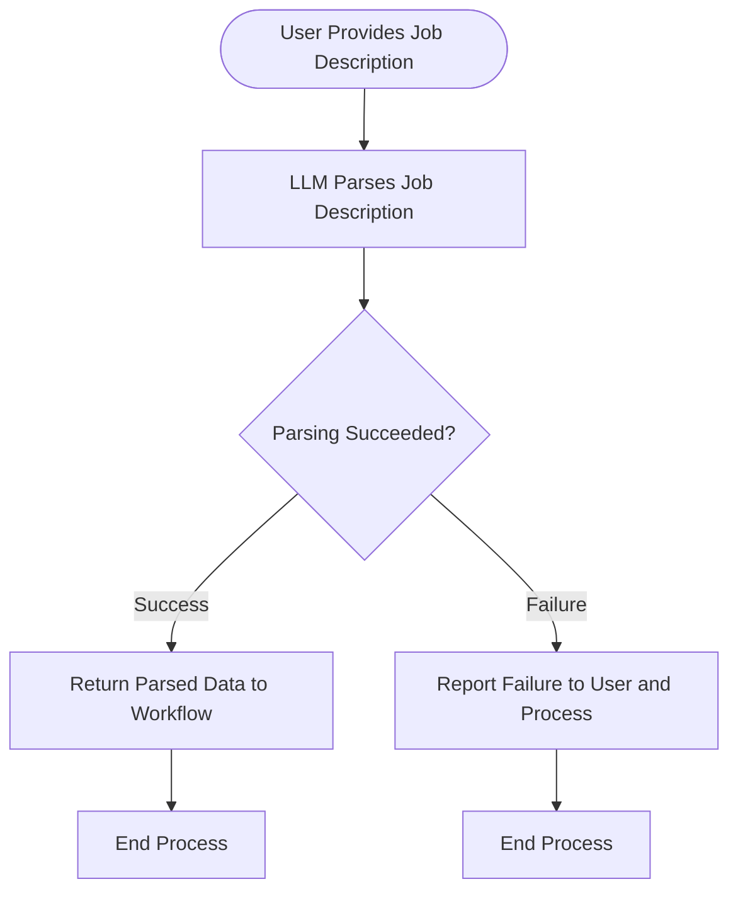

# Job Description Parsing Process

## 1. Purpose / Summary

The job description parsing process uses an LLM to extract structured information from user-provided job descriptions for targeted resume generation. This process relies entirely on AI-based extraction without deterministic processing, and any failures are reported back to the user and the overall workflow. Validation of the parsed data occurs in a separate step after this process completes.

## 2. Process Flow

## 3. Rules

- The job description must be provided in a supported text format before LLM parsing can begin
- Parsing relies exclusively on LLM-based extraction without deterministic processing methods
- Any parsing failures must be reported to the user and the overall generation process
- This process does not include validation of parsed data; that occurs in a separate step
- The LLM adapter must handle connection and response validation for parsing operations
- Parsed data is returned to the workflow regardless of content quality; validation happens separately

## 4. Constraints

- Job descriptions exceeding maximum length limits will be rejected by the LLM adapter
- Unsupported file formats or text encodings are not accepted by the LLM parser
- The process must not store job descriptions in persistent storage beyond temporary processing needs
- External parsing tools or services cannot be used without going through the configured adapter layer
- LLM operations must go through the LLM Service and its configured adapter

## 5. References

- [Job Description Schema](../../schema/job-description-schema.md)
- [Resume Generation Feature Overview](docs/system/resume-generation/overview.md)
- [Generated Resume Schema](../../schema/generated-resume-schema.md)
