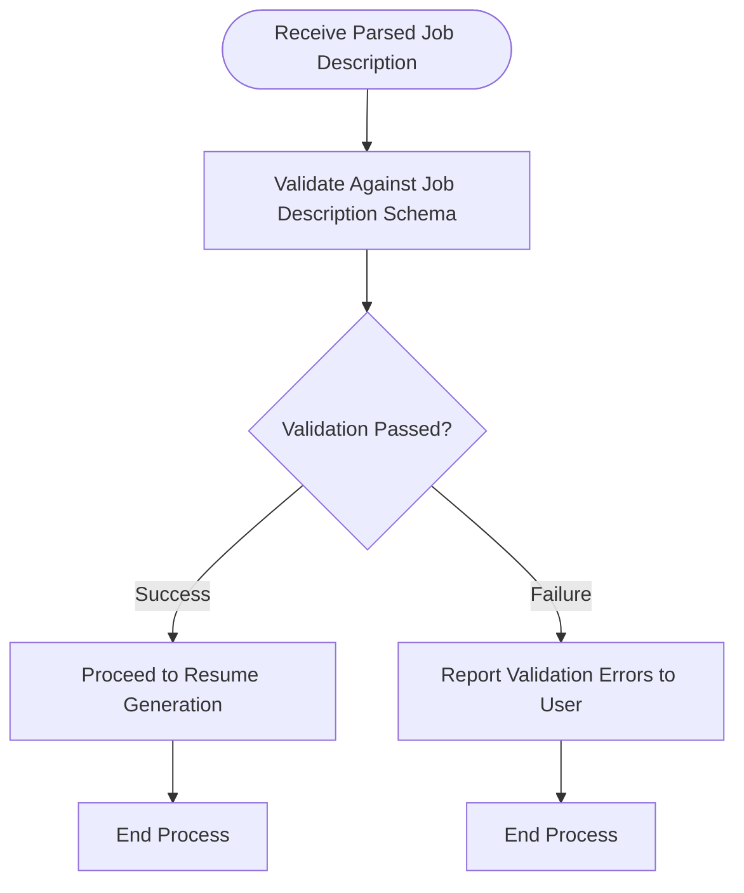

# Parsed Job Description Validation Process

## 1. Purpose / Summary

The parsed job description validation process validates the AI-extracted job description data against the Job Description JSON schema before it can be used for resume generation. This is a deterministic validation step that occurs after LLM-based parsing and ensures only properly structured data proceeds to the generation workflow. Any validation failures are reported to the user and halt the process until corrected.

## 2. Process Flow

## 3. Rules

- Parsed job description data must conform to the Job Description JSON schema before generation can proceed
- Validation is deterministic and does not involve LLM operations
- Any schema violations must be identified and reported to the user with specific error details
- The process must halt if validation fails until the user provides a corrected job description
- This step occurs after LLM parsing and before resume content generation
- Validation errors must include clear guidance on what data is missing or malformed

## 4. Constraints

- Only the Job Description JSON schema is used for validation; no other schemas apply to this step
- The process cannot proceed with invalid parsed job description data
- Users must re-enter or correct their job description if validation fails
- Validation failures are not cached or retried automatically; user intervention is required
- Schema changes require updates to both the schema definition and this validation process

## 5. References

- [Job Description Schema](../../schema/job-description-schema.md)
- [Resume Generation Feature Overview](docs/system/resume-generation/overview.md)
- [Job Description Parsing Process](2-job-description-parsing.md)
