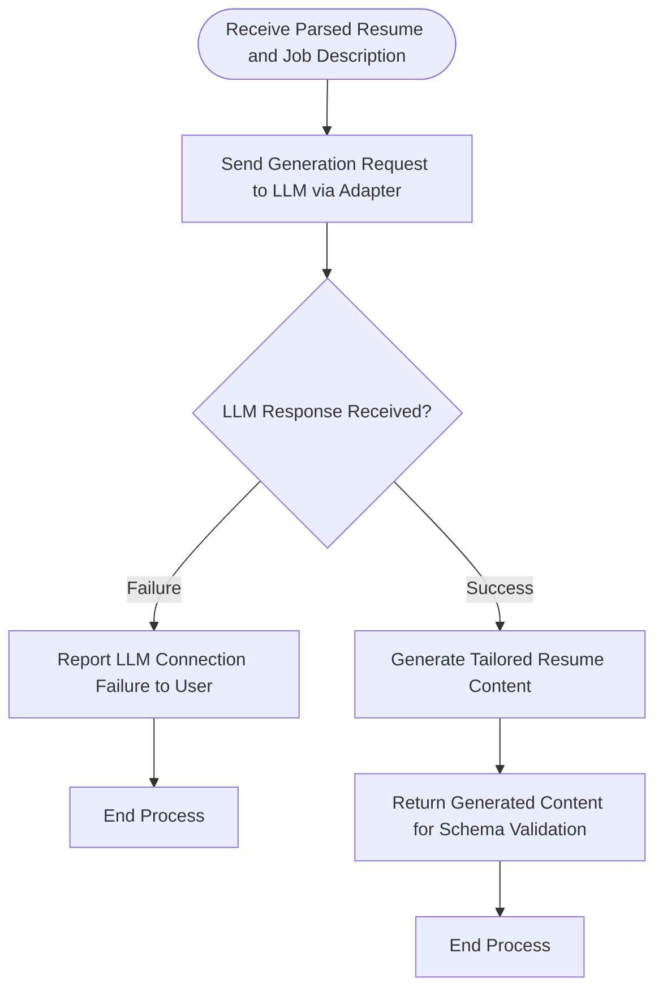

# Resume Content Generation Process

## 1. Purpose / Summary

The resume content generation process uses an LLM to create tailored resume content by combining the user's stored parsed resume data with the parsed job description requirements. This step generates customized resume content that matches the target role while respecting the constraint that no new facts about the user can be introduced. The generated content is passed to schema validation before Markdown rendering.

## 2. Process Flow

## 3. Rules

- The generation request must include both the parsed user resume and parsed job description as reference inputs
- LLM operations must go through the configured Provider and Adapter layers
- Generated content must be based exclusively on the user's stored resume data without fabrication
- The job description may guide selection, prioritization, and presentation but cannot introduce new facts about the user
- Any LLM connection or response failures must be reported to the user and halt the process
- Generated content is returned for schema validation; this process does not include validation
- The LLM adapter must handle connection and response validation for generation operations

## 4. Constraints

- Normal operation shall not depend on external cloud-based LLM services (though users may choose to use them)
- Users must provide their own LLM configuration through the adapter layer
- Generated outputs cannot exceed the maximum content length supported by the configured LLM
- The process must not store generated content in the database; output files only
- LLM operations cannot bypass the configured Provider and Adapter layers

## 5. References

- [Resume Generation Feature Overview](docs/system/resume-generation/overview.md)
- [Job Description Parsing Process](2-job-description-parsing.md)
- [Generated Resume Schema](../../schema/generated-resume-schema.md)
