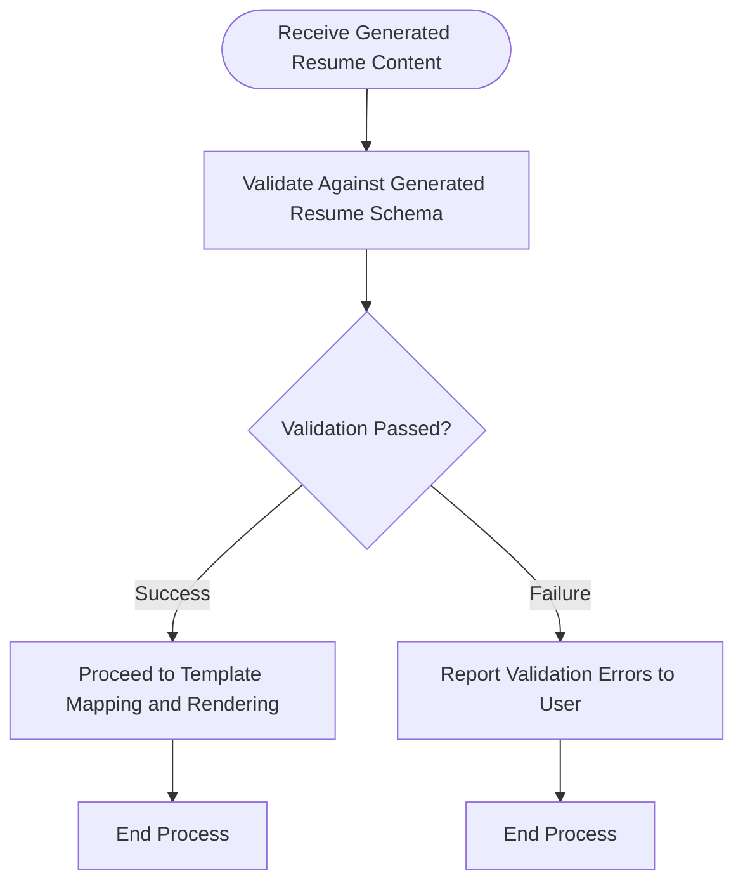

# Generated Resume Validation Process

## 1. Purpose / Summary

The generated resume validation process validates the AI-generated resume content against the Generated Resume JSON schema before Markdown rendering. This deterministic validation step ensures only properly structured data proceeds to the template mapping and rendering stages. Any validation failures are reported to the user and prevent corrupted output files from being created.

## 2. Process Flow

## 3. Rules

- Generated resume data must conform to the Generated Resume JSON schema before Markdown rendering is attempted
- Validation is deterministic and does not involve LLM operations
- Any schema violations must be identified and reported to the user with specific error details
- The process must halt if validation fails until corrected content is provided
- This step occurs after content generation and before template mapping
- Validation errors must include clear guidance on what data is missing or malformed

## 4. Constraints

- Only the Generated Resume JSON schema is used for validation; no other schemas apply to this step
- The process cannot proceed with invalid generated resume data
- Users must review and regenerate content if validation fails
- Validation failures are not cached or retried automatically; user intervention is required
- Schema changes require updates to both the schema definition and this validation process

## 5. References

- [Generated Resume Schema](../../schema/generated-resume-schema.md)
- [Resume Generation Feature Overview](docs/system/resume-generation/overview.md)
- [Resume Content Generation Process](4-resume-content-generation.md)
