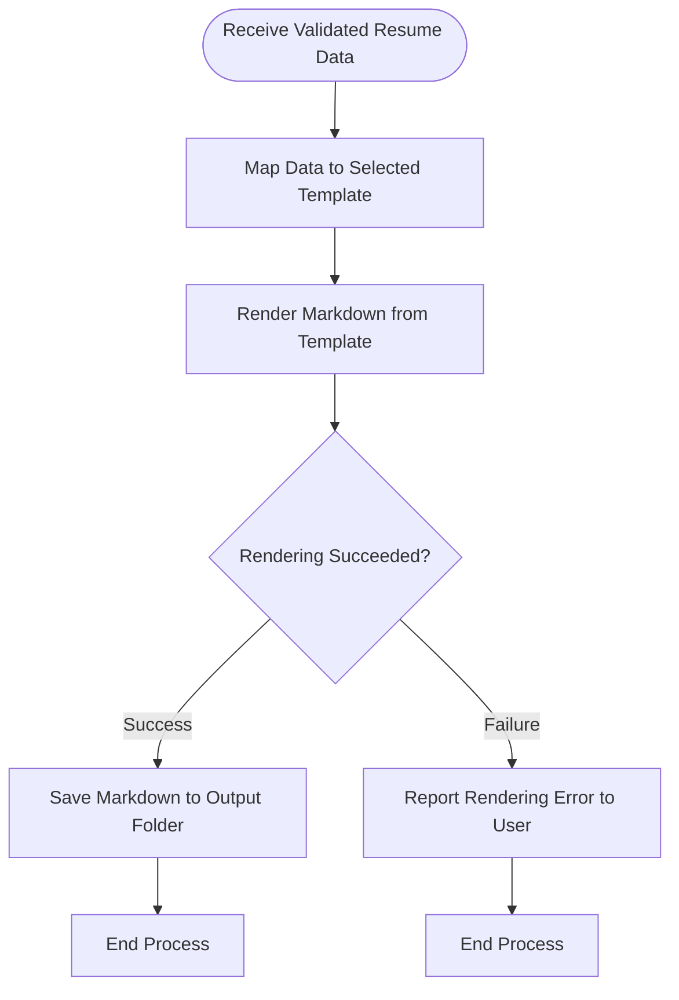

# Output Rendering Process

## 1. Purpose / Summary

The output rendering process maps the validated generated resume data to the selected resume template and renders it as a Markdown document. This step converts the structured data into a formatted Markdown file that can be saved to the designated output folder. Any rendering failures are reported to the user and prevent corrupted files from being created.

## 2. Process Flow

## 3. Rules

- Generated resume data must be mapped to the selected template before rendering can proceed
- The template must be valid and compatible with the generated resume data structure
- Markdown rendering must complete successfully before file output is attempted
- Any rendering errors must be reported to the user and prevent corrupted output files
- This step occurs after schema validation and before output storage
- Output folder creation must respect OS security permissions

## 4. Constraints

- The process cannot proceed if the selected template is invalid or incompatible
- Rendering failures are not automatically retried; user intervention may be required
- Output files must be saved in the designated output folder managed by CLI
- Output folder creation must fail gracefully if permissions are insufficient
- Markdown rendering must complete successfully before file output

## 5. References

- [Resume Generation Feature Overview](docs/system/resume-generation/overview.md)
- [Generated Resume Validation Process](5-generated-resume-validation.md)
- [Output Folder Management](../../output-folder-management.md)
