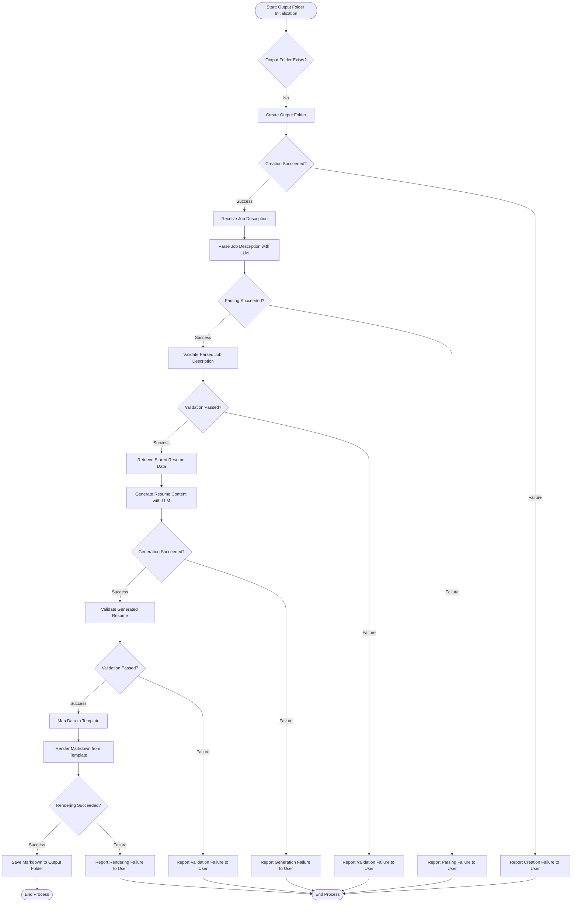

# Resume Generation Process

## 1. Purpose / Summary

The resume generation process creates tailored resume documents by combining a user's stored parsed resume data with a provided job description, using an external LLM to generate relevant content that matches the target role. This end-to-end workflow validates all inputs and outputs, handles errors gracefully, and produces a final resume document saved to the designated output folder.

## 2. Process Flow

## 3. Rules

- The output folder must exist before generation can proceed; creation fails gracefully if permissions are insufficient
- Job description must be validated and parsed before generation can proceed
- Parsed job description data must conform to the Job Description JSON schema after AI parsing
- Stored resume data must exist and pass validation before being used for generation
- Generated content must not fabricate or alter user's original information
- LLM operations must go through the configured Provider and Adapter layers
- Generated resume data must conform to the Generated Resume JSON schema before Markdown rendering
- Output files must be saved in the designated output folder managed by CLI
- Any failures at any stage must be reported to the user and halt the process until corrected

## 4. Constraints

- Generated resume content must be based exclusively on the user's stored resume data
- The job description may guide selection, prioritization, and presentation but cannot introduce new facts about the user
- Normal operation shall not depend on external cloud-based LLM services (though users may choose to use them)
- Output folder creation must respect OS security permissions and not bypass system restrictions
- Generated outputs must conform to the Generated Resume JSON schema before rendering
- The process cannot proceed if any validation step fails without user intervention

## 5. References

- [Resume Generation Feature Overview](docs/system/resume-generation/overview.md)
- [Job Description Parsing Process](2-job-description-parsing.md)
- [Parsed Job Description Validation Process](3-parsed-job-description-validation.md)
- [Resume Content Generation Process](4-resume-content-generation.md)
- [Generated Resume Validation Process](5-generated-resume-validation.md)
- [Output Rendering Process](6-output-rendering.md)
