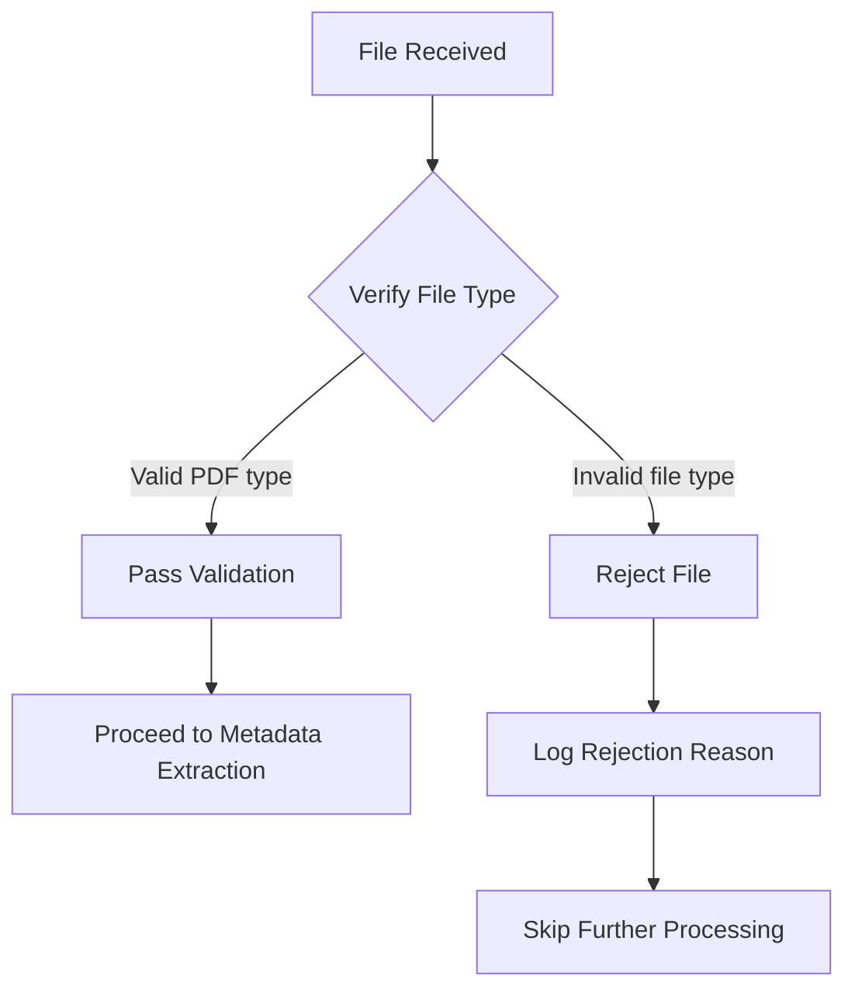

# File Type Verification Process

## 1. Purpose / Summary

This process validates that uploaded resume files are genuine PDF documents by verifying their file signature. This verification occurs before any other processing to ensure only valid PDF files enter the resume processing pipeline, preventing errors from attempting to parse non-PDF or corrupted files. The process rejects files with invalid signatures immediately and logs them for review.

## 2. Process Flow

## 3. Rules

- **must** verify file signature before any other processing step
- **must** reject files that do not match the expected PDF file type
- **must** log all rejection events with specific reason codes
- **must** pass validation only when file type matches PDF specification
- **must** not attempt content extraction on files failing signature verification
- **must** preserve original file integrity without modification during verification

## 4. Constraints

- Only files identified as valid PDF documents are accepted for further processing
- Files with signatures matching other document types are rejected
- Corrupted or truncated files are rejected
- Verification does not validate PDF content structure, only file type

## 5. References

- [Resume Processing System Overview](../overview.md)
- `app/core/services/pdf/service.py` — Implements PDF signature verification.
