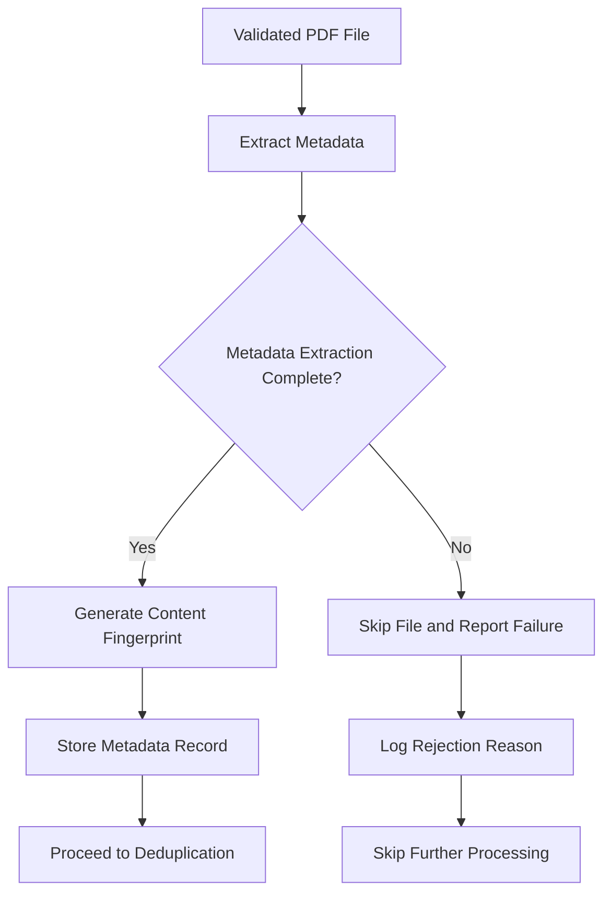

# Metadata Extraction Process

## 1. Purpose / Summary

This process extracts metadata from validated PDF resume files to enable deduplication and provide contextual information about each resume. The extracted metadata includes file properties, document characteristics, and content fingerprints that allow the system to identify duplicate resumes before they enter the parsing pipeline. This step ensures efficient processing by filtering out redundant submissions early in the workflow.

## 2. Process Flow

## 3. Rules

- **must** extract metadata only from files that passed file type verification
- **must** generate a content fingerprint for deduplication purposes
- **must** store extracted metadata in the database for later retrieval
- **must** skip and report as failure any files that fail metadata extraction
- **must** handle extraction errors gracefully without blocking the workflow
- **must** not modify or alter the original PDF file during metadata extraction
- **must** extract only non-sensitive metadata required for processing decisions
- **must** complete metadata extraction before proceeding to deduplication

## 4. Constraints

- Metadata extraction must not expose sensitive personal information beyond what is necessary for deduplication
- Extraction must be performed within reasonable time limits to avoid performance degradation
- Files failing metadata extraction are skipped and logged as failures
- Extraction failures do not prevent the file from proceeding to validation if metadata is optional

## 5. References

- [System Overview](docs/system/resume-processing/overview.md)
- [File Type Verification Process](1-file-type-verification.md)
