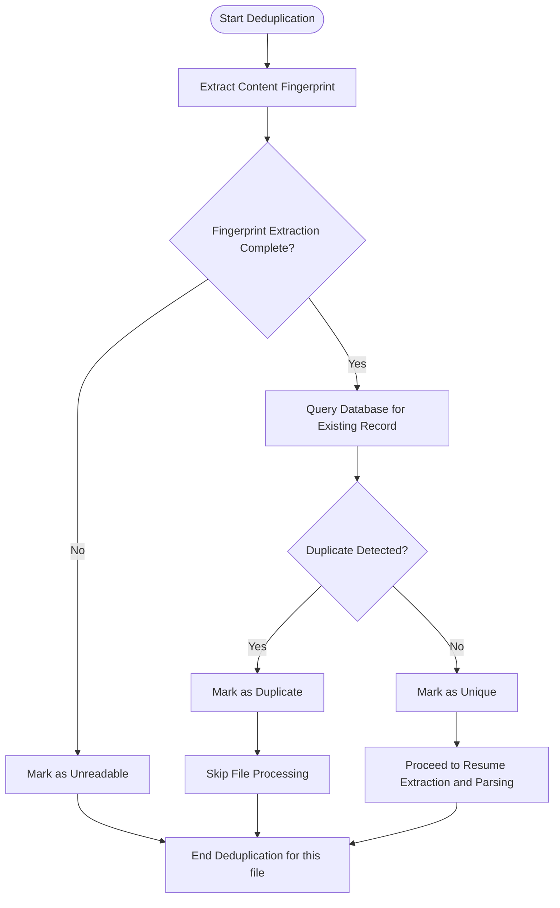

# Deduplication Process

## 1. Purpose / Summary

The Deduplication process identifies and handles duplicate resume files during the upload workflow. It compares extracted content fingerprints against existing resume records to detect duplicates. Duplicate files are skipped without creating new database records, ensuring only unique resumes are stored and processed.

This process operates after metadata extraction and before resume extraction and parsing. Each file is handled independently to maintain processing continuity.

## 2. Process Flow

## 3. Rules

- **must** extract content fingerprint from each file that passed metadata extraction
- **must** compare fingerprints against existing resume records in the database
- **must** treat files with matching fingerprints as duplicates
- **must** skip duplicate files without creating new resume records
- **must** skip and report as failure any files that fail fingerprint extraction
- **must** handle deduplication errors gracefully without blocking the workflow
- **must** not modify or alter existing files during deduplication
- **must** complete deduplication for each file before moving to the next file
- **must** report deduplication failures but not prevent processing of other files

## 4. Constraints

- The System must use the defined data models and database interfaces for storing and retrieving resume records
- File-system access is limited to reading file contents for fingerprint calculation
- No modifications to existing files or folders are permitted during deduplication
- Duplicate detection is based on content similarity, not file metadata alone
- Original PDF files in the input folder are never deleted during deduplication

## 5. References

- [Resume Processing System Overview](docs/system/resume-processing/overview.md)
- [Metadata Extraction Process](2-metadata-extraction.md)
