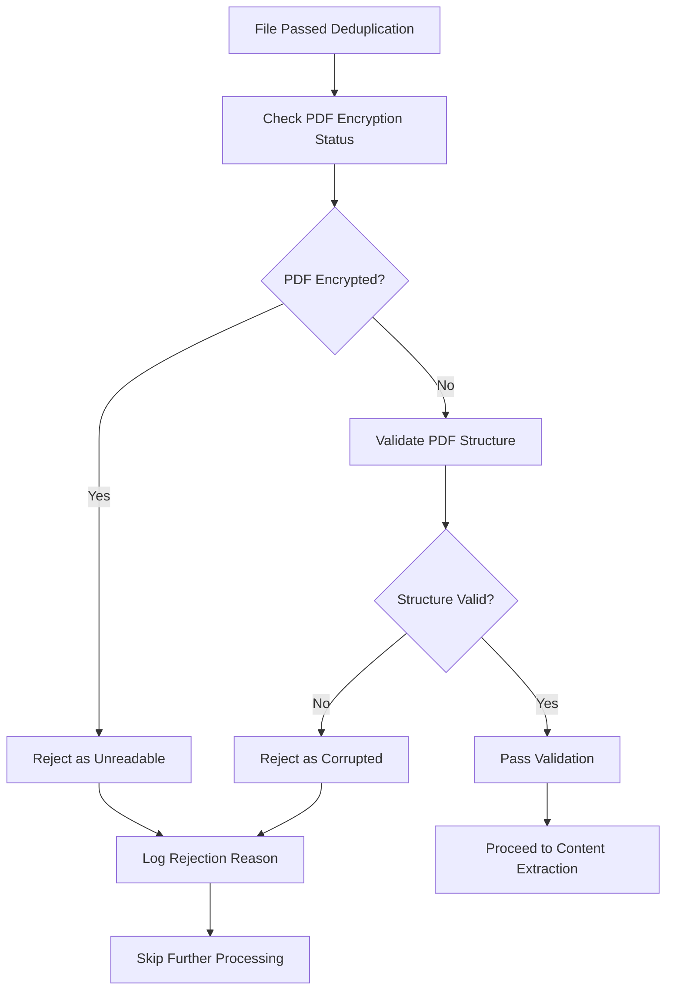

# PDF Validation Process

## 1. Purpose / Summary

This process validates that PDF resume files are structurally sound and not encrypted before attempting content extraction. The validation ensures only readable, unencrypted PDFs proceed to the parsing pipeline, preventing errors from processing corrupted or protected documents. This step occurs after deduplication and before content extraction.

## 2. Process Flow

## 3. Rules

- **must** check PDF encryption status before attempting content extraction
- **must** reject encrypted or password-protected PDF files as unreadable
- **must** validate PDF structural integrity including document catalog and page tree
- **must** reject PDFs with corrupted structure or missing required components
- **must** handle validation errors gracefully without blocking the workflow
- **must** not attempt content extraction on failed validation results
- **must** preserve original file integrity without modification during validation
- **must** complete all validation checks before proceeding to content extraction

## 4. Constraints

- Only non-encrypted PDFs are accepted for content extraction
- PDFs with structural errors or missing required components are rejected
- Validation does not assess document content quality, only structural validity
- Original PDF files in the input folder are never deleted during validation
- Validation failures are logged but do not prevent processing of other files

## 5. References

- [Resume Processing System Overview](../overview.md)
- `app/core/modules/pdf_processing.py` — Implements PDF validation.
- [Deduplication Process](3-deduplication.md)
- [Use pypdf and pdfplumber for PDF processing](../../../adr/Architecture/2026-11-04/pdf-processing.md)
