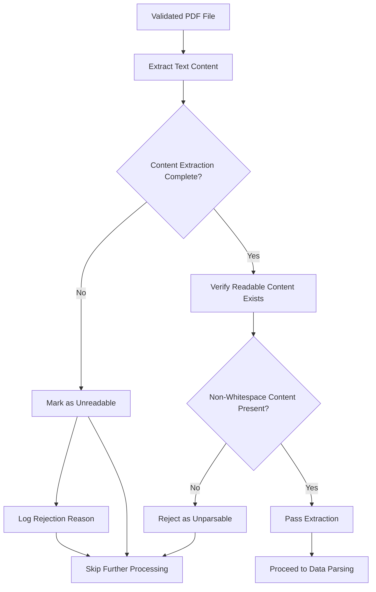

# PDF Extraction Process

## 1. Purpose / Summary

This process extracts readable text content from validated PDF resume files to enable parsing into structured data. The extraction ensures that only PDFs with at least one non-whitespace character of extracted text proceed to the parsing pipeline, preventing errors from processing blank or image-only documents. This step occurs after PDF validation and before data parsing.

## 2. Process Flow

## 3. Rules

- **must** extract text content from all pages of the PDF document
- **must** verify that extracted content contains readable text (not just images or blank pages)
- **must** reject PDFs whose extracted text contains no non-whitespace character
- **must** handle extraction errors gracefully without blocking the workflow
- **must** not modify or alter the original PDF file during extraction
- **must** complete extraction for each file before moving to the next file
- **must** report extraction failures but not prevent processing of other files

## 4. Constraints

- Only PDFs with at least one non-whitespace character of extracted text are accepted for parsing
- PDFs containing only images, graphics, or blank pages are rejected
- Extraction must be performed within reasonable time limits to avoid performance degradation
- Original PDF files in the input folder are never deleted during extraction
- Extraction failures are logged but do not prevent processing of other files

## 5. References

- [Resume Processing System Overview](../overview.md)
- [PDF Validation Process](4-pdf-validation.md)
- `core/src/core/modules/pdf_processing.py` — Implements PDF text extraction.

