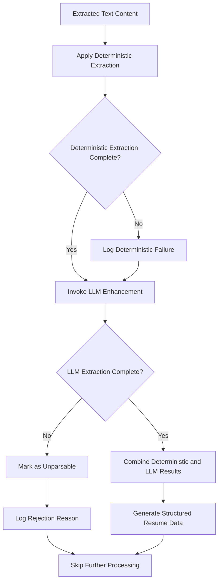

# Data Parsing Process

## 1. Purpose / Summary

This process parses extracted text content from validated PDF resumes into structured resume data using a two-stage approach: deterministic extraction followed by LLM-based enhancement. Both methods are always invoked to ensure comprehensive data extraction, with the LLM supplementing information that cannot be reliably extracted through deterministic methods alone. This step occurs after content extraction and before schema validation.

## 2. Process Flow

## 3. Rules

- **must** apply deterministic extraction methods first to all extracted text content
- **must** always invoke LLM enhancement after deterministic extraction, regardless of deterministic results
- **must** combine results from both deterministic and LLM extraction methods
- **must** handle deterministic extraction errors gracefully by proceeding to LLM
- **must** handle LLM extraction errors by skipping the file and reporting failure
- **must** not skip either extraction method under any circumstances
- **must** preserve original document content without fabrication or alteration
- **must** complete parsing for each file before moving to the next file
- **must** report parsing failures but not prevent processing of other files

## 4. Constraints

- Deterministic methods are used first as the primary extraction approach
- LLM is always invoked as a secondary enhancement, not only on failure
- Combined results must conform to the Resume JSON schema before storage
- Parsing must be performed within reasonable time limits to avoid performance degradation
- Original PDF files in the input folder are never deleted during parsing
- Parsing failures are logged but do not prevent processing of other files

## 5. References

- [Resume Processing System Overview](../overview.md)
- [PDF Extraction Process](5-pdf-extraction.md)
- [Schema Validation Process](7-schema-validation.md)
