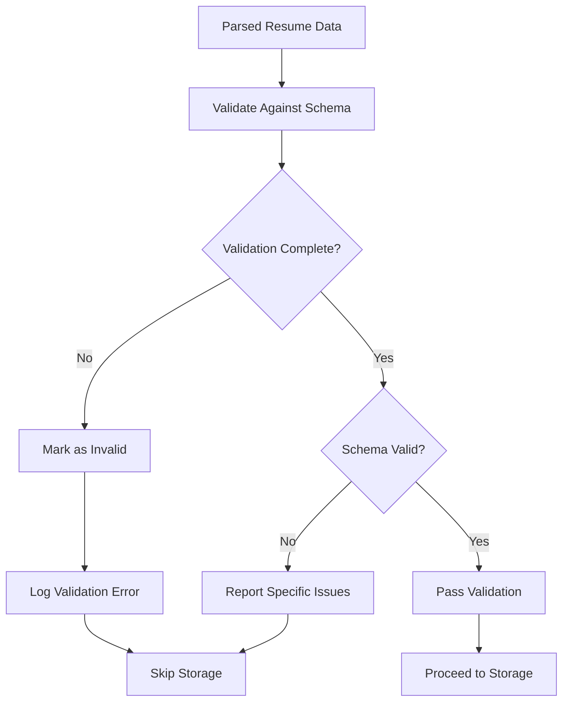

# Schema Validation Process

## 1. Purpose / Summary

This process validates parsed resume data against the Resume JSON schema to ensure completeness and correctness before storage. The validation confirms that all required fields are present and conform to the defined structure, preventing invalid or incomplete data from being stored in the database. This step occurs after data parsing and before storage.

## 2. Process Flow

## 3. Rules

- **must** validate parsed resume data against the Resume JSON schema before storage
- **must** report specific validation issues when schema requirements are not met
- **must** reject data that fails schema validation and does not store it
- **must** handle validation errors gracefully without blocking the workflow
- **must** complete validation for each file before moving to the next file
- **must** preserve original document content without alteration during validation
- **must** report validation failures but not prevent processing of other files

## 4. Constraints

- Only data conforming to the Resume JSON schema is accepted for storage
- Validation must be performed within reasonable time limits to avoid performance degradation
- Original PDF files in the input folder are never deleted during validation
- Validation failures are logged but do not prevent processing of other files
- Schema validation does not assess content quality, only structural compliance

## 5. References

- [Resume Processing System Overview](../overview.md)
- [Data Parsing Process](6-data-parsing.md)
- [User Resume Data Model](../../../data/user-resume.md)
