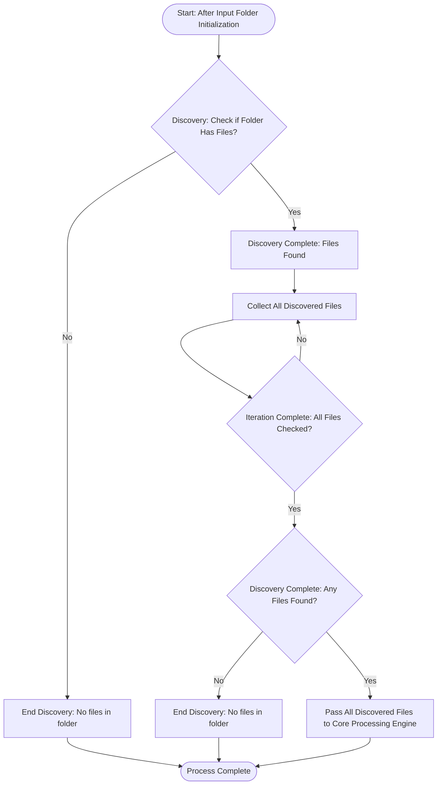

# Input Folder Content Discovery

## 1. Purpose / Summary

This process checks the contents of the input folder after initialization to discover files for resume processing. It performs a single operation: it discovers whether any files exist in the input folder and collects all discovered files. All discovered files are then passed to the Core Processing Engine for further processing, including file type validation, extraction, parsing, and deduplication. If no files are found after discovery, the process reports that there are no eligible files to process and ends without proceeding to the Core Processing Engine.

## 2. Process Flow

The following diagram represents the file discovery flow within the iteration. This process iterates through all discovered files in the input folder. The iteration continues until every discovered file has been checked for existence. Once all files have been processed, the iteration ends and the process determines whether any files were found to proceed to the Core Processing Engine or report that no eligible files exist.

## 3. Rules

- The process must check whether the input folder contains any files before proceeding with file collection.
- All discovered files must be passed to the Core Processing Engine for further processing, including file type validation and extraction.
- Each file must be handled independently so that a failure affecting one file does not prevent processing of other files.
- File processing failures must be isolated at the individual file level; a failure in processing one file must not interrupt or stop the processing of remaining files.
- The process must not perform file type validation itself - this is handled by the Core Processing Engine.
- The process must not filter files based on file type - all discovered files are eligible for processing.
- If no files are found after discovery, the process must end and report that there are no eligible files to process.

## 4. Constraints

- The process must not access or scan file-system locations unrelated to the designated input folder.
- The process must not create, modify, delete, rename, or move any files within the input folder during discovery.
- File system access must be limited to discovering files within the designated input folder and performing the checks required for file existence identification.
- The process must not perform operations beyond what is required for file discovery.
- The process must not attempt to read or parse the contents of any files.
- The process must not validate PDF document integrity, encryption status, password protection, or readable-content requirements.
- The process must not recursively discover files in subdirectories unless explicitly supported by the upload requirements.

## 5. References

- [Resume Upload](docs/system/resume-upload/overview.md)
- [Input Folder Initialization](1-input-folder-initialization.md)
