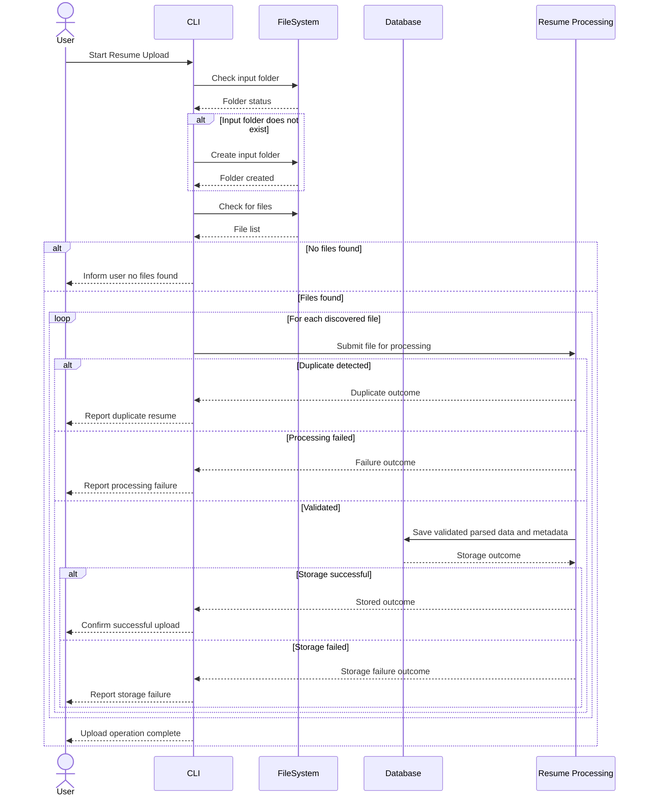

# Resume Upload Process

## 1. Purpose / Summary

The Resume Upload process manages the discovery and initial handling of resume files in CVBrewer's designated input folder. It checks folder accessibility, discovers files, and coordinates with the Core Processing Engine to process discovered files.

The Core Processing Engine stores successfully parsed resume data and associated metadata when required storage conditions are satisfied. Each file is handled independently so that a failure affecting one file does not prevent the remaining files from being processed.

## 2. Process Flow

## 3. Rules

- The input folder must exist and be accessible before files can be processed.
- If the input folder does not exist, the system must attempt to create it according to the application's folder-management rules.
- If the input folder cannot be accessed or created, the upload operation must report the failure and stop because file processing cannot proceed.
- If the input folder is empty, the upload operation must end and report the outcome without attempting to process resume files.
- All discovered files must be passed to the Core Processing Engine for further processing.
- Each discovered file must be handled independently.
- A failure affecting one file must not prevent the remaining files from being processed unless a system-level failure prevents further execution.
- The system must not perform file type validation - this is handled by the Core Processing Engine.
- The system must not perform deduplication - this is handled by the Core Processing Engine.
- Only successfully parsed resume data that satisfies the required validation and storage conditions may be stored as a valid resume record through the Core Processing Engine.
- Failed extraction or parsing operations must not result in invalid resume records being stored.
- A failed database operation must be reported or recorded as appropriate by the Core Processing Engine.
- The system must not report a file as successfully stored unless the Core Processing Engine confirms successful storage through processing confirmation.
- The upload operation is complete only after all discovered files have reached a final outcome.
- The system may report the current processing stage for each discovered file during processing.
- Final outcomes may include successful storage, duplicate detection, file-type rejection, processing failure, or storage failure.
- An empty input folder is a normal completion outcome, not an error.

## 4. Constraints

- The system must use the defined resume file inputs and processing outcomes when coordinating with the Core Processing Engine.
- The system must not perform storage operations or assume a specific storage implementation; the Core Processing Engine owns storage through the Database Service.
- The system must not delete, rename, move, modify, or create files within the input folder or other existing file-system locations.
- The system may create the designated output folder if it does not exist, according to the application's folder-management rules.
- The system must not modify or delete existing files or folders.
- File-system access must be limited to the operations required by the system's defined responsibilities.
- The system must not perform any database operations directly - all data management is handled by the Core Processing Engine through the Database Service.
- The system must not directly reference specific database implementation details or database adapters.

## 5. References

- [Input Folder Initialization](1-input-folder-initialization.md)
- [Input Folder Initialiation](1-input-folder-initialization.md)
- [File Metadata Model](resume-file-metadata.md)
